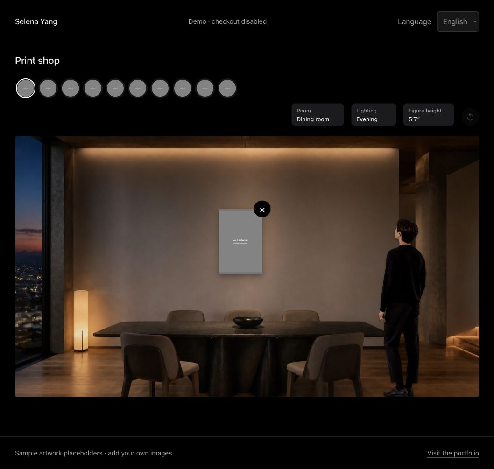

# Print Shop

An interactive print viewing room extracted from [Selena Yang's art portfolio](https://selenayang.art/#viewing-room).



Compare print sizes against a scale figure, place multiple artworks on a wall, and switch between rooms and lighting. The preview combines a photo-backed WebGL shader with draggable DOM image overlays. It is a simulated room, not camera-based augmented reality, and its scale is an estimate rather than a measurement of a visitor's actual room.

## Run locally

Requires Node.js 20 or newer. No dependency installation or build step is needed.

```sh
npm start -- --port 4173
```

Open `http://127.0.0.1:4173`. Use another port if it is occupied.

```sh
npm test
```

## Included

- Up to four independently movable works on one wall.
- Dining room, office, and entryway environments with day, evening, and gallery lighting.
- Adjustable scale figure, inches/centimeters, print-size selection, and contextual purchase controls.
- Artwork details dialog, keyboard controls, responsive layouts, and reduced-motion styling.
- English, Chinese, and Korean UI dictionaries. Some inherited control labels remain English.
- Ten generic catalog entries using two gray artwork placeholders. Demo prices are illustrative, not current store prices.

## Safe demo mode

Checkout is **disabled by default**. No Storefront token, Admin API token, production variant IDs, analytics configuration, customer records, or private source scans are included.

The purchase control still displays the selected size and illustrative price, but cannot navigate to a real checkout until configured. The demo does not fetch stock or live prices.

### Connect your own Shopify store

1. In `data/works.js`, replace the sample prices and add the numeric Shopify variant ID to each print's `variant` field. Use variants published and available in your store.
2. Set `shopify.domain` in `config.js` to your `your-store.myshopify.com` domain.
3. Set `checkoutEnabled: true` only when the catalog is ready for real orders.

The default integration uses Shopify cart permalinks: `https://<store>/cart/<variant>:1`. Checkout is hosted by Shopify; this demo does not process payments or store customer data. No API token is needed for that flow. Live stock, price synchronization, taxes, shipping, and fulfillment are not implemented in this repository. The catalog price must be maintained by you; Shopify's checkout determines the final price and availability.

**Never add Admin API credentials, app secrets, or private tokens to browser code.** Everything in this static site is public. Add a server-side integration separately if you need privileged API access.

## Catalog

`data/works.js` assigns an array to `window.WORKS`. Each entry includes:

```js
{
  title: 'Your artwork',
  slug: 'your-artwork',
  year: 2026,
  medium: 'Acrylic on canvas',
  dimensions: '36 x 24 in',
  orientation: 'portrait',
  imagePath: 'images/art/your-artwork.webp',
  collection: 'Your collection',
  prints: [
    { size: '18 x 12 in', price: '$40', variant: '' }
  ]
}
```

Dimensions are **height x width, in inches**. An optional `roomDimensions` overrides the preview dimensions. Use trusted, locally maintained catalog data; the inherited renderer is not a CMS sanitizer for arbitrary user input.

To use your own artwork, edit the `DEMO_ITEMS` entries in `data/works.js` or replace them with your own `window.WORKS` array, then point `imagePath` at images you are allowed to share. The shipped gray placeholders do not contain any paintings.

## Structure

| Path | Purpose |
| --- | --- |
| `src/room.js` | Room renderer, GLSL shaders, scale calculations, controls, purchase state |
| `src/app.js` | Standalone mount and artwork-detail navigation |
| `src/artwork-details.js` | Accessible native dialog for artwork details |
| `src/i18n.js` / `data/translations.js` | Language switching and feature-specific strings |
| `styles/feature.css` | Styles extracted from the original room feature |
| `styles/base.css` | Standalone shell, dialog, and responsive defaults |
| `config.js` | Public checkout settings, disabled by default |
| `scripts/serve.mjs` | Dependency-free local static server |
| `tests/` | Catalog, syntax, asset, and safety checks |

Public renderer API: `RoomView.create({ mode: 'standalone' })`, then `mount(viewer, panel, controls)` and `show(workIndex)`. `refresh()` recalculates layout after a hidden container becomes visible. This extraction is intended for one persistent page; it does not yet provide an SPA teardown API.

## Publish a demo

The repository root is the complete static site. Publish it with GitHub Pages or any static host. No build command is required; serve the root directory. Asset paths are relative so a GitHub Pages project subdirectory works. Do not publish `.env` files, `.git`, private records, or source scans.

The existing portfolio deployment is separate and is not changed by this repository.

## Rights

No artwork by Selena Yang is included. This repository does not yet grant an open-source code license; see [RIGHTS.md](RIGHTS.md) and [ASSETS.md](ASSETS.md). The room photographs may have separate rights, so do not assume they are freely reusable.
